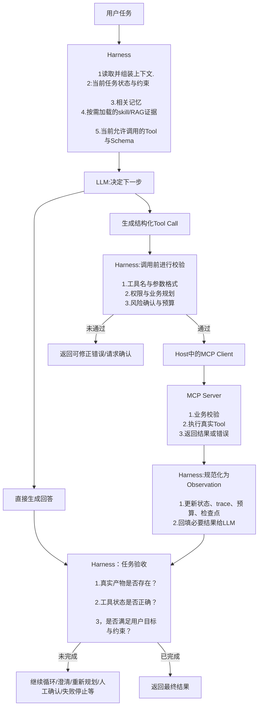

面试复盘

1.**请完整说明一个 Agent 从收到用户任务到最终结束的执行流程。**  
需要说明模型、Harness、Tool/MCP Server 分别做什么，以及为什么 Tool 返回成功不等于任务完成。

- 用户任务进入后，Harness先去读取当前任务状态、已确认约束、相关记忆和按需加载的Skill、RAG证据，再只暴露当前允许使用的Tool及其Schema给LLM。

- LLM根据上下文选择直接回答，或者生成结构化Tool Call。若需要调用工具，Harness先校验工具名、参数、权限、风险和预算；通过后由Host中对应的MCP Client按协议请求MCP Server。

- MCP Server负责业务校验和真实执行，并返回结构化结果或者错误信息。

- Harness将结果整理为Observation，持久化更新状态、trace、预算和检查点，再回填给LLM决定下一步。最后由Harness根据真实产物、工具状态和任务验收条件，决定继续、澄清、人工确认、失败停止或向用户返回结果。

- Tool成功只表示这一次工具执行成功，不代表用户任务已经完成。例如查询接口成功返回数据，但数据可能不足以回答问题；测试命令执行成功，也不代表业务目标已经满足。

用户任务

Harness在输入、输出和LLM运行中都在发挥作用。

输入的时候，主要和上下文相关的内容。包括组装上下文、Skill、RAG、Tool和Schema和规范边界等。

输出的时候，主要是进行任务验收。判断结果是不是对的，满足用户要求的。满足约束的。是否需要用户进行确认的。

Harness 会在调用前执行全局风险、预算和人工确认策略。

MCP Server 应作为资源侧的最终控制点，强制执行权限、业务规则和数据边界；

2.**公司内部助手既要处理“请假、盖章、实验下单”等固定流程，也要处理“我遇到问题，该设计什么实验”的开放任务。你会怎样选择 Workflow、Agent 或混合架构？Harness 在其中处于什么位置？**

- 对请假、盖章、实验下单这类步骤、规则和审批条件明确的任务，我使用workflow，由程序控制固定路径、条件分支和人工审批，保证稳定和可审计。

- 对“遇到一个问题该涉及什么实验”这类目标明确但路径未知的任务，我在相应节点使用Agent，让模型结合上下文、资料和工具动态探索方案。

- 实际上更适合混合架构：外层Workflow负责固定流程、权限、审批和最终验收；不确定性高的节点交给Agent推理和调用工具。Harness则贯穿两者，负责上下文、状态、工具校验、预算、重试、停止和验收，而不是Workflow的替代品。

3.**一个制造业知识查询 Agent 的答案将支撑用户决策。你如何让它的结论尽量可信？**  
不只说 RAG，还请说明证据、关键数值、工具执行、证据不足和高风险决策分别如何处理。

- 把可信性拆解成证据、验证和风险控制三层。

- 首先，知识类结论必须尽量基于可追溯的权威来源，并保留文档版本、来源和引用片段。RAG负责检索证据，但要通过上下文相关性、忠实度等指标在离线阶段评估检索和生成质量。

- 对价格、库存、参数、合规状态等关键数值，不能让模型自由生成，应该通过受权限控制的Tool查询数据库或业务系统，并把查询结果作为依据。对执行类任务，还要在动作后查询真实状态或运行测试，不能相信模型自称完成。

- 当证据不足、来源冲突或超出知识边界时，Agent应明确不确定、请求澄清或转人工；高风险决策和高风险操作由Harness触发人工确认，Server强制执行权限和业务规则。最后通过trace、离线评测和线上案例回流，持续发现问题。

**一个“实验下单”Workflow 的某一步缺少用户填写的关键参数，应该由 Workflow、Agent 还是 Harness 处理？为什么？**

固定请假、盖章、下单-> 固定 Workflow。开放分析、方案探索、复杂排障-> Agent。两类任务都有-> 混合架构。

混合系统收到一个具体请求后，需要决定走哪条已经定义好的路径。

规则或者程序先处理明确请求，模糊请求再交给LLM分类。而是明确请求还是模糊请求，可以交给LLM来进行判断。LLM在这里承担一个受限的分类节点。

workflow作为Skill输入给LLM，并不能代替真正的workflow。

举个例子，如果把请假流程写入Skill：先核对假期余额，再填写日期，再提交审批。

模型可能会跳过步骤，颠倒顺序，甚至没有审批完就宣布完成了。它本质上仍然是LLM在根据Prompt自由决定下一步。

而程序化 Workflow ，模型即使参与某个节点，也不能跳过系统规定的审批和校验。

~~一个“实验下单”Workflow 的某一步缺少用户填写的关键参数，这个时候应该由Harness在用户输入的时候就自动检索到了，然后提醒用户进行输入。~~

Harness 可以参与入口路由，但不应默认把每个请求都交给 LLM 判断。明确、低风险、固定的请求直接进入 Workflow；只有意图模糊或确实需要判断时，才让 LLM 作为受限分类节点参与路由。

LLM 可以协助从自然语言中抽取已有参数，但“哪些字段必填、是否缺失、值是否合法”仍应由 Workflow 的规则或 Schema 校验决定。所以在Harness对用户的输入进行处理时，是不能够察觉到参数缺失。

Harness 在尚未确定业务路径、没有对应 Schema 时，无法判断缺少哪些业务参数；一旦请求已进入实验下单 Workflow，Harness 就可以调用该节点的 Schema 校验，发现缺参、暂停流程、追问用户并在补充后恢复执行。

补充：

Prompt：当前任务的直接指令和上下文。
Skill：某类任务可按需加载的流程、约束、资料和脚本包。
Memory：保存过去信息，并在当前需要时检索回填上下文的机制。

上下文压缩是控制短期上下文长度；它不等于自动把短期记忆写成长期记忆。长期记忆是否写入，应由专门的写入策略决定。
